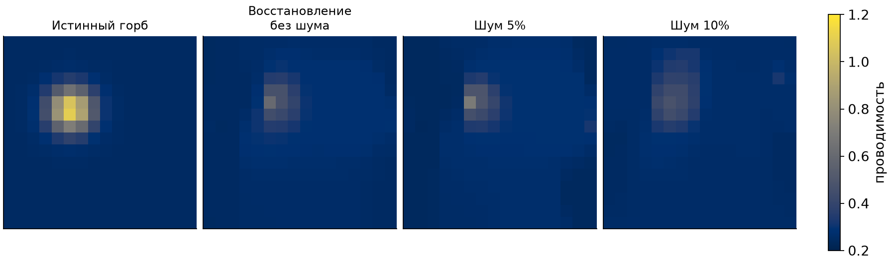

# Найти скрытую проводимость по редким термометрам

Пластина греется. Тепло идёт быстрее там, где материал лучше проводит. Проводимость нигде не измерена напрямую. Известна температура, и то не везде: датчики стоят на 5% клеток. По этим показаниям нужно восстановить карту проводимости.

Расчёт идёт в обратную сторону. Сначала температура прогоняется вперёд по уравнению тепла. Потом JAX проходит тот же путь назад и говорит, в какую сторону подвинуть проводимость, чтобы датчики сошлись. Проводимость не может стать отрицательной: она проходит через softplus.

Скрытое поле — гладкий горб. На сетке 16×16 он доходит до 1.10. Оптимизатор начинает с ровного поля около 0.74 и горб не видит.



Жёлтое — высокая проводимость. Восстановленный горб стоит примерно в том же месте, но он бледнее. При шуме 5% и 10% картинка не разваливается и не уезжает в бесконечность. Похожесть на истинное поле, SSIM, получилась 0.48 без шума, 0.48 при шуме 5% и 0.49 при шуме 10%. Порог задания был 0.85. Он не взят: по пяти процентам клеток высокий узкий горб и более плоское пятно объясняют датчики почти одинаково.

## Что просили и что вышло

| | Просили | Получилось |
| --- | --- | --- |
| SSIM при 5% датчиков | больше 0.85 | 0.483 |
| Шум 5% и 10% не ломает оптимизацию | да | оба поля конечные |
| Чекпоинтинг снижает память хотя бы на 60% | да | с 321 536 до 23 940 байт, минус 92.6%. Это оперативная память процесса, не память видеокарты |
| Градиент сходится как остаток второго порядка | да | да, график ниже |

До этой версии штраф был квадратом перепадов. SSIM тогда был 0.474, максимум восстановленного поля 0.52. Полная вариация, корень из суммы квадратов соседних перепадов, подняла SSIM до 0.483 и максимум до 0.61. Истинный горб на сетке — 1.10. Высоту восстановить не удалось. Ошибка на самих датчиках при этом падает сильно: с 2.4×10⁻³ до 1.9×10⁻⁵. Датчики объясняются, форма горба нет.

## Проверка, что градиент настоящий

Берётся направление и маленький шаг ε. Считается, насколько настоящий сдвиг функции отличается от сдвига, предсказанного градиентом. Если градиент верный, этот остаток уменьшается как ε².


Серая линия — остаток, делённый на ε. Когда шаг проверки уменьшается в десять раз, она тоже падает примерно в десять раз. Синяя — остаток, делённый на ε². Она стоит на месте, около 2×10⁻⁷. Так и должен выглядеть второй порядок.

Три точки, из которых собран график:

| ε | остаток / ε | остаток / ε² |
| --- | --- | --- |
| 10⁻² | 2.18×10⁻⁹ | 2.18×10⁻⁷ |
| 10⁻³ | 2.24×10⁻¹⁰ | 2.24×10⁻⁷ |
| 10⁻⁴ | 3.36×10⁻¹¹ | 3.36×10⁻⁷ |

Память экономится так: длинный прогон режется на куски по 4 шага. На обратном пути кусок пересчитывается, а не хранится целиком. Это практическая форма биномиального чекпоинтинга.

## Запуск

```bash
python3.12 -m venv .venv
source .venv/bin/activate
pip install -r requirements.txt
python -m src.inverse
```

Числа — `runs/metrics.json`. Поля проводимости — `runs/kappa_clean.npy` и два файла с шумом.
