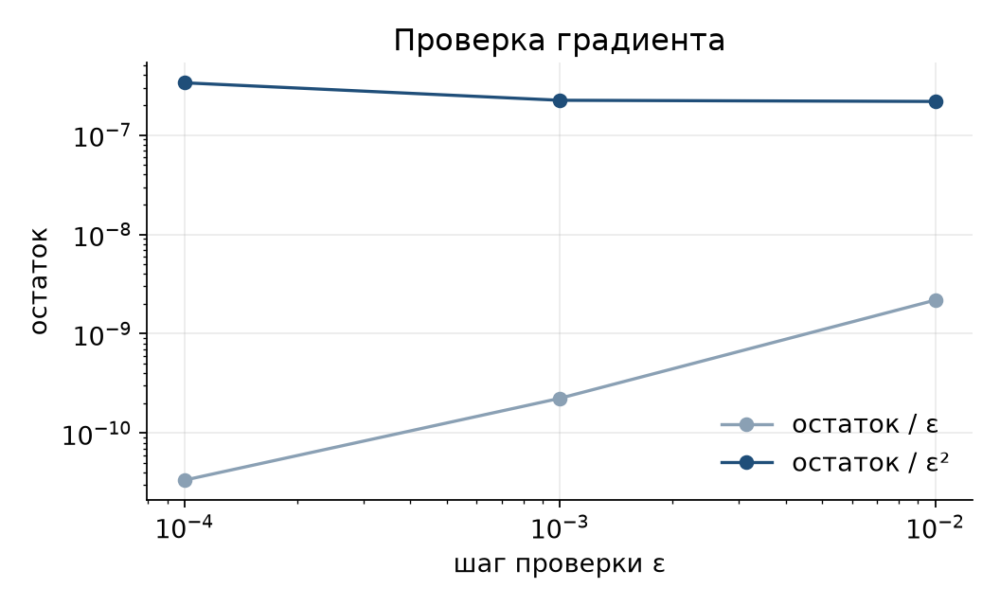

# Recover a hidden conductivity from a few thermometers

A plate is heating up. Heat moves faster where the material conducts better. Conductivity is never measured directly. Temperature is known, and only in places: sensors cover 5% of the cells. From those readings the conductivity map has to be recovered.

The calculation runs backwards. First the temperature is rolled forward through the heat equation. Then JAX walks the same path in reverse and says which way to nudge the conductivity so the sensors agree. Conductivity cannot go negative: it passes through a softplus.

The hidden field is a smooth bump. On the 16×16 grid it reaches 1.10. The optimizer starts from a flat field near 0.74 and never sees the bump.


Yellow is high conductivity. The recovered bump sits in about the same place, and it is paler. With 5% and 10% noise the picture stays finite. It does not blow up. Similarity to the true field, SSIM, is 0.48 with no noise, 0.48 with 5% noise, and 0.49 with 10% noise. The requested limit was 0.85. It is missed: with five percent of the cells, a tall narrow bump and a flatter spot explain the sensors about equally well.

## What was asked, and what came out

| | Asked | Measured |
| --- | --- | --- |
| SSIM at 5% sensor coverage | above 0.85 | 0.483 |
| 5% and 10% noise does not break the optimization | yes | both fields stay finite |
| Checkpointing cuts memory by at least 60% | yes | 321,536 bytes down to 23,940, minus 92.6%. This is the process’s RAM, not GPU memory |
| The gradient matches a second-order Taylor remainder | yes | yes, the plot below |

Before this version the penalty was the square of neighboring jumps. SSIM was then 0.474, and the tallest recovered value was 0.52. Smoothed total variation, the square root of the sum of squared neighbor jumps, raised SSIM to 0.483 and the maximum to 0.61. The true bump on the grid is 1.10. Its height was not recovered. The error on the sensors themselves still drops a lot, from 2.4×10⁻³ to 1.9×10⁻⁵. The sensors are explained. The shape of the bump is not.

## Checking that the gradient is real

Take a direction and a small step ε. Compare the real change in the loss with the change predicted by the gradient. If the gradient is right, the leftover shrinks like ε².



The gray line is the remainder divided by ε. When the test step shrinks by ten, this line drops by about ten as well. The blue line is the remainder divided by ε². It stays put, near 2×10⁻⁷. That is what second order looks like.

The three points the plot is drawn from:

| ε | remainder / ε | remainder / ε² |
| --- | --- | --- |
| 10⁻² | 2.18×10⁻⁹ | 2.18×10⁻⁷ |
| 10⁻³ | 2.24×10⁻¹⁰ | 2.24×10⁻⁷ |
| 10⁻⁴ | 3.36×10⁻¹¹ | 3.36×10⁻⁷ |

Memory is saved by cutting the long rollout into chunks of 4 steps. On the way back, a chunk is recomputed instead of stored whole. That is a practical form of binomial checkpointing.

## Run

```bash
python3.12 -m venv .venv
source .venv/bin/activate
pip install -r requirements.txt
python -m src.inverse
```

The numbers are in `runs/metrics.json`. The conductivity fields are `runs/kappa_clean.npy` and the two noisy files.
